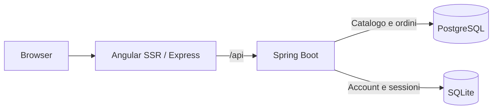

# Flower Bro!

Negozio online di bouquet e fiori recisi, con catalogo, preferiti, carrello e invio degli ordini.


[Avvio in locale](#installazione-e-avvio) · [Architettura](#architettura) · [API](#api) · [Deploy](#deploy)

## Panoramica

Flower Bro! permette di scegliere fiori per un regalo, confrontare le composizioni e inviare un ordine con i dati del destinatario e una dedica. L’interfaccia è in italiano e si adatta a desktop e smartphone.

## Architettura

Angular gestisce l’interfaccia e il rendering lato server. Il browser invia le richieste `/api` alla stessa origine del sito ed Express le inoltra a Spring Boot su loopback.



- **Model** — `AccountService` gestisce autenticazione e sessioni con `AccountStore` su SQLite. `CatalogStore` e `OrderStore` leggono e scrivono i dati del negozio in PostgreSQL.
- **View** — I template HTML e CSS di Angular mostrano catalogo, schede prodotto, preferiti, carrello, checkout e profilo.
- **Controller** — I componenti Angular gestiscono le interazioni con i template. Sul backend, `AccountController` e `StoreController` ricevono le richieste HTTP e restituiscono JSON.

## Stack tecnologico

| Componente | Tecnologie |
| --- | --- |
| Frontend | Angular 22, TypeScript e CSS |
| Rendering lato server | Angular SSR, Node.js ed Express 5 |
| Backend | Java 25, Spring Boot 4.1, Spring MVC e Gradle Wrapper |
| Persistenza | PostgreSQL 18 per catalogo e ordini, SQLite per account e sessioni |
| Database locale | Docker Compose e migrazioni Flyway |

## Funzionalità principali

- **Catalogo** — Ricerca per nome, composizione o tag. Filtri per tipo di fiore e occasione, ordinamento per prezzo o valutazione e schede con foto e disponibilità.
- **Preferiti e carrello** — Salvataggio nel browser, modifica delle quantità e riepilogo del totale.
- **Account** — Registrazione, accesso, profilo e logout.
- **Checkout** — Invio dei dati di consegna con dedica facoltativa, anche senza account. La conferma mostra il numero d’ordine e il totale calcolato dal server.
- **Gestione degli ordini** — Il backend usa i prezzi del catalogo, verifica le quantità, registra l’ordine con stato `pending` e aggiorna le giacenze tracciate nella stessa transazione. Se riceve di nuovo lo stesso checkout, restituisce la ricevuta già registrata.

## Installazione e avvio

### Prerequisiti

- Git, Docker e Docker Compose.
- JDK 25 LTS. Su Windows, imposta `JAVA_HOME` sulla cartella del JDK 25 se `java -version` indica una versione precedente.
- Node.js 22 dalla versione 22.22.3, Node.js 24 dalla versione 24.15.0 oppure Node.js 26, con npm.
- PowerShell per lo script del database. Su macOS e Linux usa `pwsh`.

### 1. Clona il repository e prepara il frontend

```sh
git clone https://github.com/lorenzdellacostanza-dot/flowerbro.git
cd flowerbro/frontend
npm ci
npm run setup:local
```

`setup:local` crea la chiave degli account in `frontend/.env` al primo avvio e riutilizza il file se è già presente.

### 2. Avvia PostgreSQL e Spring Boot

Con Docker in esecuzione, apri un secondo terminale nella radice di `flowerbro`. Lo script avvia PostgreSQL, applica le migrazioni con i dati iniziali e configura l’utente applicativo.

**Windows (PowerShell)**

```powershell
cd backend
.\Start-Database.ps1
.\gradlew.bat bootRun
```

**macOS e Linux**

```sh
cd backend
pwsh ./Start-Database.ps1
./gradlew bootRun
```

### 3. Avvia Angular

Torna al terminale aperto in `frontend`, esegui `npm start` e apri [localhost:4200](http://localhost:4200/). Spring Boot ascolta su `127.0.0.1:8080`, mentre PostgreSQL è esposto su `127.0.0.1:5433`.

Per provare il rendering lato server, esegui `npm run build` e `npm run serve:ssr:frontend` da `frontend` con il backend in esecuzione. Apri [127.0.0.1:4000](http://127.0.0.1:4000/).

## Struttura del repository

```text
flowerbro/
├── frontend/
│   ├── public/                           # Font e immagini editoriali
│   ├── scripts/setup-local.mjs           # Configurazione locale degli account
│   ├── src/app/components/               # Pagine e componenti Angular
│   ├── src/app/services/                 # Catalogo, carrello, checkout e account
│   └── src/server.ts                     # Server SSR e proxy API
└── backend/
    ├── src/main/java/it/flowerbro/       # Controller, servizi e persistenza
    ├── src/main/resources/db/migration/  # Migrazioni PostgreSQL e dati iniziali
    ├── Start-Database.ps1                # Preparazione del database locale
    └── compose.yaml                      # PostgreSQL, Flyway e configurazione del ruolo
```

## Design system

L’interfaccia usa **Instrument Serif** per i titoli e **Quicksand** per il testo. La palette combina il fondo avorio `#FAF7F0`, il rosa scuro `#783847` e il verde salvia `#E9EBDF`. [Stili globali](frontend/src/styles.css)

## API

| Metodo e percorso | Descrizione |
| --- | --- |
| `GET /api/catalog` | Carica prodotti attivi, disponibilità, tag e occasioni. |
| `POST /api/orders` | Registra l’ordine e restituisce la ricevuta. |
| `POST /api/account/register` | Registra un account e apre una sessione. |
| `POST /api/account/login` | Accede con un account esistente. |
| `GET /api/account` | Legge il profilo della sessione corrente. |
| `POST /api/account/logout` | Revoca la sessione e rimuove il cookie. |

## Sicurezza e dati

- Le password sono protette con **scrypt** e un salt casuale. Nome, email e dati di consegna sono cifrati con **AES-256-GCM**. L’indice dell’email degli account usa HMAC.
- Il database degli account conserva l’hash del token di sessione. Il cookie usa `HttpOnly` e `SameSite=Strict`, con `Secure` in produzione. Le sessioni scadono dopo sette giorni e il logout le revoca. Registrazione e login hanno limiti di frequenza.
- PostgreSQL usa TLS e un ruolo applicativo distinto dal ruolo di amministrazione e migrazione. [Guida del database](backend/README.md)
- In locale, profili e sessioni persistono in `.flowerbro/auth.sqlite`. Le installazioni esistenti riutilizzano il file SQLite e la chiave di `frontend/.env`. Conserva le chiavi separatamente dai backup.

## Deploy

Esegui Spring Boot e Angular SSR sullo stesso host. Usa un volume privato e persistente per SQLite e un reverse proxy HTTPS sullo stesso host per esporre Angular SSR. Il proxy deve reindirizzare HTTP a HTTPS, inoltrare il dominio canonico in `Host` e sovrascrivere `X-Forwarded-Proto` e `X-Forwarded-For` con i valori della richiesta.

| Variabile d’ambiente | Servizio | Impostazione |
| --- | --- | --- |
| `FLOWERBRO_ORIGIN` | Java e Angular SSR | Origine HTTPS pubblica, ad esempio `https://flowerbro.example`. |
| `FLOWERBRO_BACKEND_PORT` | Java e Angular SSR | Porta interna di Spring Boot. Predefinita `8080`. |
| `FLOWERBRO_DB_PATH` | Java | Percorso assoluto di SQLite sul volume privato, fuori da `frontend`. |
| `FLOWERBRO_DATA_KEY` | Java | Chiave degli account di 32 byte in Base64url. |
| `SPRING_PROFILES_ACTIVE` | Java | `production`. |
| `NODE_ENV` | Angular SSR | `production`. |
| `PORT` | Angular SSR | Porta interna del server SSR. Predefinita `4000`. |

Imposta anche i parametri TLS e le chiavi degli ordini, applica le migrazioni e configura il ruolo applicativo. [Configurazione PostgreSQL per la produzione](backend/README.md#configurazione-di-produzione)

Mantieni le stesse chiavi e lo stesso volume persistente tra i rilasci. Per generare una chiave degli account su una nuova installazione, esegui `node -p "require('node:crypto').randomBytes(32).toString('base64url')"` e salva il valore nel gestore dei segreti dell’host.

Dalla cartella `backend`, esegui `./gradlew bootJar` oppure `.\gradlew.bat bootJar` su Windows. Avvia il pacchetto con Java 25.

```sh
java --enable-native-access=ALL-UNNAMED -jar build/libs/flowerbro-backend.jar
```

Dalla cartella `frontend`, installa le dipendenze, compila e avvia il server SSR.

```sh
npm ci --include=dev
npm run build
npm run serve:ssr:frontend
```

Pagamenti online, gestione delle spedizioni, verifica dell’email e recupero della password richiedono integrazioni dedicate.

## Crediti

Repository del progetto a cura di [Lorenz Dellacostanza](https://github.com/lorenzdellacostanza-dot).

Struttura del README ispirata a [CigarClubApp](https://github.com/Marco-Pagnanini/CigarClubApp/blob/main/README.md).
